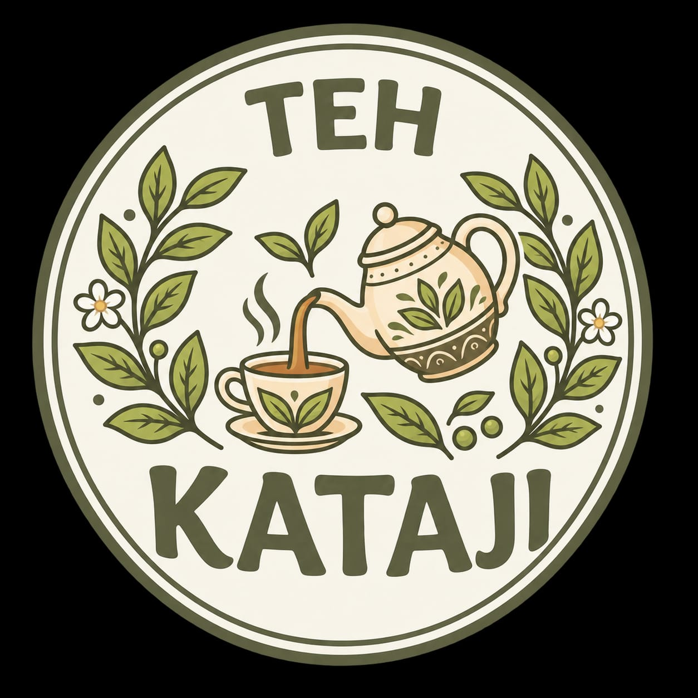

<h1>Es Teh Kataji</h1>
</img>

A. Identitas Produk Perangkat Lunak
Nama Aplikasi / Software: Teh Kataji (TehKataji berbasis web)
Kategori Produk: Penjualan Online
Deskripsi Singkat Fungsi Aplikasi:
Teh Kataji adalah aplikasi penjualan online yang dirancang untuk membantu pedagang UMKM dalam pencatatan transaksi penjualan secara real-time, pencetakan dan manajemen stok barang berbasis cloud Supabase.

B. Analisis Perlindungan HAKI Produk
Hak Cipta (Copyright):
Objek Yang Dilindungi:
Kode Sumber (Source Code) HTML/CSS dan javascript untuk antarmuka pengguna (frontend) dan Django, Python, dan mySQL (backend).
Desain Antarmuka (UI/UX Design) yang dibuat menggunakan Figma (file layout, skema warna, dan ikon kustom).
Dokumen Petunjuk Penggunaan (User Manual) berbentuk README.md untuk kasir.
Pernyataan Hak Cipta: Hak Cipta © 2026 oleh Muhammad Sayidhan Sahid. Seluruh hak dilindungi undang-undang.
Merek (Trademark):
Nama Brand: Teh Kataji
Logo & Elemen Visual: Logo ikon berbentuk logo Teh Kataji

Fungsi Perlindungan: Mencegah pengembang lain membuat aplikasi serupa dengan nama atau logo yang membingungkan konsumen.

